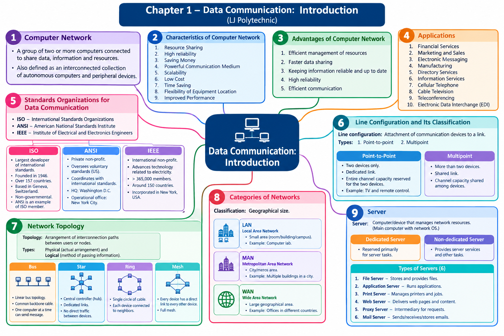

# LJ-DCN-sem3-chapter1-explained

---

# DCN Chapter 1 — Data Communication: Introduction

Source: Uploaded DCN Unit 1 PPT · LJ Polytechnic

We'll follow your requested workflow in order: deep explanation, complete text mind map, mind map image, MCQs, then 1-mark, 2-mark, 3-mark, and 4/5-mark questions, followed by a coverage checklist. I'll preserve the PPT's terminology and flag details that the slides don't explain rather than inventing slide content.

## STEP 1 — Deep Explanation

### 1. Introduction to Computer Networks

Definition: A computer network is a group of two or more computers connected so that they can share data, information, and resources.

The PPT also defines a computer network as an interconnected collection of autonomous computers and peripheral devices.

Let's understand the important terms:

- Interconnected: Devices are connected to one another through communication links.
    
- Autonomous computers: Computers that can operate independently.
    
- Peripheral devices: Devices such as printers and other equipment connected to computers.
    
- Data and information sharing: Exchanging files, messages, and other information.
    
- Resource sharing: Allowing multiple computers to use shared equipment or services.
    

Example: In a college computer laboratory, several computers may share a printer and exchange files over the same network.

### Simple computer network diagram

Computer A

Network connection

Computer B

Shared printer

Illustration: computers connected through a network can exchange information and share resources.

Important exam point: Remember both definitions given in the PPT, particularly the phrase interconnected collection of autonomous computers and peripheral devices.

### 2. Characteristics of a Computer Network

The PPT lists nine characteristics.

|Characteristic|Simple explanation|Example|
|---|---|---|
|Resource Sharing|Multiple users can share hardware, software, or information.|Several computers use one printer.|
|High Reliability|Network-based services can be designed to remain available despite certain failures.|A backup server may provide service if another server fails.|
|Saving Money|Sharing resources can reduce the need to purchase separate equipment.|One shared printer instead of one per computer.|
|Powerful Communication Medium|Networks enable communication between people and devices.|Email and online messaging.|
|Scalability|The network can be expanded as requirements grow.|Adding more computers to a college network.|
|Low Cost|Sharing equipment and services can reduce overall costs.|Sharing a network storage device.|
|Time Saving|Data and services can be accessed without physically transferring files between computers.|Sending an assignment electronically.|
|Flexibility of Equipment Location|Connected equipment can be used from different locations, subject to network access.|Accessing a shared file from another room.|
|Improved Performance|Networked systems can improve work efficiency through shared services and coordinated computing.|Multiple users accessing a centralized application.|

Exam note: The PPT lists both Saving Money and Low Cost separately. Keep both in your revision notes even though their meanings overlap.

### 3. Advantages of a Computer Network

The PPT identifies five advantages.

1. Efficient management of resources: Shared resources can be managed centrally or made available to multiple users.
    
2. Faster data sharing: Files and information can be transferred between connected computers.
    
3. Keeping information reliable and up to date: Users can access updated information maintained in a shared location.
    
4. High reliability: Properly designed networks can help maintain access to services when individual components fail.
    
5. Efficient communication: Users can communicate and exchange information quickly through network services.
    

Example: A college can store examination timetables in a shared location so that staff members can access the latest version instead of maintaining separate copies.

Important distinction: The PPT presents characteristics and advantages as separate lists. For an exam question asking for the advantages, reproduce the five points from the advantages slide.

### 4. Applications of Computer Networks

The PPT lists ten applications.

|Application|Explanation and example|
|---|---|
|Financial Services|Network-based banking, electronic transactions, and financial information exchange.|
|Marketing and Sales|Online advertising, order processing, and selling products through websites.|
|Electronic Messaging|Sending and receiving messages through email and messaging systems.|
|Manufacturing|Exchanging production information and coordinating manufacturing operations.|
|Directory Services|Maintaining and providing access to organized information about users or network resources.|
|Information Services|Providing information through online databases, websites, and information systems.|
|Cellular Telephone|Supporting communication through cellular networks.|
|Cable Television|Delivering television services through cable networks.|
|Teleconferencing|Holding meetings with participants at different locations using communication technology.|
|Electronic Data Interchange (EDI)|Exchanging structured business documents electronically between organizations.|

Example: When a business electronically exchanges a purchase order with a supplier, it is using Electronic Data Interchange.

Exam point: Be able to recall all ten applications, including the less obvious ones: Directory Services, Cable Television, and Electronic Data Interchange.

### 5. Standards Organizations for Data Communication

A standard is an agreed set of rules or specifications that helps devices, systems, or organizations work compatibly.

The PPT identifies three standards organizations:

|Abbreviation|Full form|
|---|---|
|ISO|International Standards Organizations (as written in the PPT)|
|ANSI|American National Standards Institute|
|IEEE|Institute of Electrical and Electronics Engineers|

These organizations help develop or coordinate standards relevant to data communication and technology.

#### 5.1 ISO — International Standards Organization

The PPT describes ISO as the world's largest developer and publisher of international standards.

Points given in the PPT:

- Founded in 1946, according to the slide.
    
- An international organization composed of national standards bodies.
    
- The slide mentions members from over 157 countries, with one member per country.
    
- Based in Geneva, Switzerland.
    
- Coordinates the international standards system.
    
- A non-governmental organization that bridges the public and private sectors.
    
- ANSI is given as an example of an ISO member.
    

Example: International standards help products and systems from different countries work according to compatible specifications.

Exam point: Remember ISO's role, its headquarters in Geneva, and the relationship with ANSI. The founding date and membership figures above are reproduced from the PPT.

#### 5.2 ANSI — American National Standards Institute

ANSI is described in the PPT as a private, nonprofit organization that oversees the development of voluntary consensus standards for products, services, processes, systems, and personnel in the United States.

Its responsibilities and details include:

1. Oversees the development of voluntary standards in the United States.
    
2. Coordinates US standards with international standards.
    
3. Helps American products be used worldwide through standards coordination.
    
4. Headquarters: Washington, D.C.
    
5. Operational office: New York City.
    

Example: Coordinating national and international standards can help products designed for one market meet requirements in another.

#### 5.3 IEEE — Institute of Electrical and Electronics Engineers

The PPT describes IEEE as an international, nonprofit professional organization that advances technology related to electricity.

The slide also states:

- It has members in around 150 countries.
    
- It mentions more than 365,000 members.
    
- It is incorporated in the state of New York, United States.
    

Example: IEEE develops technical standards used in networking and electronic communication.

Important exam comparison

|Organization|Main point to remember|
|---|---|
|ISO|International standards development and publication|
|ANSI|Voluntary consensus standards and coordination in the United States|
|IEEE|Professional organization advancing electrical and electronic technology|

### 6. Line Configuration and Its Classification

Definition: Line configuration defines the attachment of communication devices to a communication link.

The PPT identifies two types:

1. Point-to-point
    
2. Multipoint
    

### A. Point-to-point configuration

Definition: Exactly two devices are connected by a dedicated link. The link carries traffic only between those connected devices.

The entire channel capacity is reserved for transmission between the two devices.

Device A

Dedicated link

Device B

Example from the PPT: The line configuration between a television and its remote control.

### B. Multipoint configuration

The PPT names multipoint as the second type but does not provide a detailed written definition on the supplied slide.

In standard networking terminology, a multipoint configuration is a link shared by more than two devices.

Shared communication link

Device A

Device B

Device C

The multipoint definition and diagram are standard explanatory additions, not a detailed definition supplied by the PPT.

|Point-to-point|Multipoint|
|---|---|
|Connects exactly two devices|Shared by more than two devices|
|Uses a dedicated link between the pair|Devices share a communication link|
|Entire channel capacity is reserved for the two connected devices, according to the PPT|Channel capacity is shared, depending on the implementation|

Exam point: Learn the definition of line configuration, both classifications, the meaning of dedicated, and the television–remote example.

### 7. Network Topology

Definition: Network topology refers to the way the interconnection paths between users or nodes are arranged.

The PPT divides topology into two types.

- Physical topology: The actual arrangement of cables, computers, and other peripherals in a network.
    
- Logical topology: The method used to pass information between workstations.
    

For example, the physical arrangement describes where network cables and devices are connected. The logical arrangement describes how information travels between devices.

Important difference

|Physical topology|Logical topology|
|---|---|
|Actual physical arrangement of the network|Method of information transmission|
|Concerns cables, computers, and peripherals|Concerns how data passes between workstations|
|Answers: “How are devices physically connected?”|Answers: “How does information travel?”|

The PPT introduces four topologies: bus, star, ring, and mesh.

#### 7.1 Bus topology


[fintechshield.co.in](https://www.fintechshield.co.in/post/bus-topology-in-networking-simple-yet-foundational?utm_source=chatgpt.com)

Definition: Bus topology, also called linear bus topology, connects several computers to one long common cable that acts as the backbone of the network.

Characteristics from the PPT:

- Multiple computers are attached to a common cable.
    
- The common cable acts as the network backbone.
    
- Only one computer at a time can send a message, as stated in the PPT.
    

Simplified diagram

```
[PC 1]       [PC 2]       [PC 3]       [PC 4]
   |             |            |            |
===+=============+============+============+===
              Common backbone cable
```

Example: A traditional small network in which several computers share one main communication cable.

Exam point: The alternative name linear bus topology, the common backbone, and the one-computer-at-a-time statement are key PPT facts.

#### 7.2 Star topology


[ccbp.in](https://www.ccbp.in/blog/articles/star-topology-in-computer-networks?utm_source=chatgpt.com)

Definition: In star topology, each device has a dedicated point-to-point link to a central controller, usually called a hub.

The PPT states that star topology does not allow direct traffic between devices.

Simplified diagram

```
              [PC 1]
                 |
                 |
[PC 2] ------ [HUB] ------ [PC 3]
                 |
                 |
              [PC 4]
```

How it works: If PC 1 needs to communicate with PC 3, the communication passes through the central hub rather than using a direct device-to-device link.

Example: A computer laboratory in which every computer connects to a central networking device.

Exam point: Remember central controller/hub, dedicated point-to-point links, and no direct traffic between devices as stated in the PPT.

#### 7.3 Ring topology


[codango.com](https://codango.com/what-is-a-network-topology-explained-like-youre-five-but-cooler/?utm_source=chatgpt.com)

Definition: In ring topology, computers are connected in a single circle of cable.

Simplified diagram

```
       [PC 1] -------- [PC 2]
          |               |
          |               |
       [PC 4] -------- [PC 3]
```

The connections form a closed loop. The PPT does not specify a particular direction of data flow or a token-passing mechanism, so those details should not be treated as facts from this slide.

Example: A network arranged in a circular connection, with each computer linked to its neighboring computers.

Exam point: The key defining phrase is computers connected on a single circle of cable.

#### 7.4 Mesh topology


[slideshare.net](https://www.slideshare.net/slideshow/chapter-1-introduction-data-communication-by-forouzan/265451754?utm_source=chatgpt.com)

Definition: In mesh topology, every device has a dedicated point-to-point link to every other device.

Simplified diagram

```
       [A] -------- [B]
        |\          /|
        | \        / |
        |  \      /  |
        |   \    /   |
        |    \  /    |
        |    /  \    |
        |   /    \   |
        |  /      \  |
        | /        \ |
       [C] -------- [D]
```

The diagram illustrates a full mesh of four devices: every device is directly connected to the other three.

Example: A system in which each device has a direct link to every other device.

Exam point: The defining feature is that every device has a dedicated point-to-point link to every other device.

#### Topology comparison

|Topology|Main structure|Key identifying feature|
|---|---|---|
|Bus|One common cable|Shared backbone|
|Star|Central hub/controller|Each device links to the centre|
|Ring|Closed circle|Devices form a loop|
|Mesh|Multiple direct links|Every device connects directly to every other device in a full mesh|

### 8. Categories of Networks

The PPT classifies networks according to their geographical size into three primary categories.

|Category|Full form|General coverage|
|---|---|---|
|LAN|Local Area Network|A limited area, such as a room, building, or campus|
|MAN|Metropolitan Area Network|A metropolitan area or city|
|WAN|Wide Area Network|A large geographical area, potentially across countries|


LAN — Local Area Network

Connects devices over a relatively small geographical area.

Example: Computers connected in a computer laboratory.


MAN — Metropolitan Area Network

Covers a metropolitan area, such as a city.

Example: A network connecting multiple buildings across a city.


WAN — Wide Area Network

Covers a large geographical area.

Example: A network connecting offices in different countries.

Important exam point: The classification criterion is geographical size. Memorize the three abbreviations and their full forms.

### 9. Server

Definition: According to the PPT, a server is a computer or device on a network that manages network resources. The PPT also describes a server as the main computer on which the network operating system is loaded.

The PPT lists two server types and six server roles/types.

#### 9.1 Dedicated server and non-dedicated server

- Dedicated server: In standard networking terminology, a server reserved primarily for server tasks.
    
- Non-dedicated server: A computer that provides server services while also being used for other tasks.
    

These are standard explanatory definitions because the PPT names the two types but does not define them further.

#### 9.2 Server roles listed in the PPT

|Server type|Main function|
|---|---|
|File Server|Stores and provides access to files.|
|Application Server|Provides or runs applications for clients.|
|Print Server|Manages access to printers and print jobs.|
|Web Server|Delivers web pages and other web content.|
|Proxy Server|Acts as an intermediary for requests between clients and other servers.|
|Mail Server|Sends, receives, or stores email messages.|

Example: When students access a website, a web server can deliver its pages. When several computers send documents to one shared printer, a print server can coordinate the print jobs.

Exam point: Memorize all six server roles and their basic purposes. The PPT does not provide further detailed descriptions of these server types.

## Chapter Summary

This chapter introduces the fundamentals of data communication and computer networks.

- Computer network: Interconnected autonomous computers and peripheral devices that share data, information, and resources.
    
- Characteristics: Resource sharing, high reliability, saving money, powerful communication medium, scalability, low cost, time saving, flexibility of equipment location, and improved performance.
    
- Advantages: Efficient resource management, faster data sharing, updated information, high reliability, and efficient communication.
    
- Applications: Financial services, marketing and sales, electronic messaging, manufacturing, directory services, information services, cellular telephone, cable television, teleconferencing, and EDI.
    
- Standards organizations: ISO, ANSI, and IEEE.
    
- Line configuration: Point-to-point and multipoint.
    
- Topology: Physical and logical; the four topologies introduced are bus, star, ring, and mesh.
    
- Network categories: LAN, MAN, and WAN, classified according to geographical size.
    
- Servers: Dedicated and non-dedicated servers; file, application, print, web, proxy, and mail servers.
    

## Important Definitions

1. Computer Network: An interconnected collection of autonomous computers and peripheral devices that can share data, information, and resources.
    
2. Line Configuration: The arrangement defining how communication devices are attached to a link.
    
3. Point-to-Point: A configuration in which exactly two devices are connected by a dedicated link.
    
4. Topology: The arrangement of interconnection paths between network users or nodes.
    
5. Physical Topology: The actual arrangement of network cables, computers, and peripherals.
    
6. Logical Topology: The method used to pass information between workstations.
    
7. Bus Topology: A topology in which several computers connect to a long common backbone cable.
    
8. Star Topology: A topology in which each device has a dedicated link to a central controller, usually a hub.
    
9. Ring Topology: A topology in which computers are connected in a single circle of cable.
    
10. Mesh Topology: A topology in which every device has a dedicated point-to-point link to every other device.
    
11. Server: A computer or device that manages network resources.
    
12. LAN: Local Area Network.
    
13. MAN: Metropolitan Area Network.
    
14. WAN: Wide Area Network.
    
15. EDI: Electronic Data Interchange.
    

## Important Differences

|Comparison|Main difference|
|---|---|
|Physical vs. Logical topology|Actual physical arrangement vs. method of data transmission|
|Point-to-point vs. Multipoint|Dedicated connection between two devices vs. a shared link for multiple devices|
|Bus vs. Star|Common backbone cable vs. central hub|
|Ring vs. Mesh|Circular connection vs. direct connections between every pair of devices in a full mesh|
|LAN vs. MAN vs. WAN|Small local area vs. metropolitan area vs. wide geographical area|
|Dedicated vs. Non-dedicated server|Primarily reserved for server tasks vs. server tasks combined with other uses|

## Important Exam Points

Learn the two definitions of a computer network provided in the PPT.

Memorize the nine network characteristics and five advantages as separate lists.

Know the full forms and main roles of ISO, ANSI, and IEEE.

Distinguish point-to-point from multipoint and physical topology from logical topology.

Practice identifying bus, star, ring, and mesh topologies from diagrams.

Memorize LAN, MAN, WAN and the six server types listed in the PPT.

Source coverage note: The explanation follows the 19-slide PPT. The multipoint configuration and dedicated/non-dedicated server definitions were expanded using standard networking knowledge because the slides only list these classifications. The supplied PPT does not give detailed protocols, topology advantages/disadvantages, or detailed server implementation information.

## STEP 1 complete

Next, we'll create the complete text-based mind map containing all major topics and subtopics from the PPT. After that, we'll generate the mind map image in Step 3, followed by the question bank in your requested order.

Say next to continue to Step 2.

---




---

# STEP 2 — Complete Text-Based Mind Map

Chapter: DCN — Data Communication: Introduction

This mind map follows the topics in your uploaded PPT and includes the major lists, classifications, definitions, and examples for revision.

```

DATA COMMUNICATION: INTRODUCTION
│
├── 1. COMPUTER NETWORK
│   ├── Definition
│   │   ├── Two or more connected computers
│   │   ├── Share data and information
│   │   └── Share resources
│   └── Interconnected collection
│       ├── Autonomous computers
│       └── Peripheral devices
│
├── 2. CHARACTERISTICS OF COMPUTER NETWORK
│   ├── Resource Sharing
│   ├── High Reliability
│   ├── Saving Money
│   ├── Powerful Communication Medium
│   ├── Scalability
│   ├── Low Cost
│   ├── Time Saving
│   ├── Flexibility of Equipment Location
│   └── Improved Performance
│
├── 3. ADVANTAGES OF COMPUTER NETWORK
│   ├── Efficient Management of Resources
│   ├── Faster Data Sharing
│   ├── Keeping Information Reliable and Up to Date
│   ├── High Reliability
│   └── Efficient Communication
│
├── 4. APPLICATIONS
│   ├── Financial Services
│   ├── Marketing and Sales
│   ├── Electronic Messaging
│   ├── Manufacturing
│   ├── Directory Services
│   ├── Information Services
│   ├── Cellular Telephone
│   ├── Cable Television
│   ├── Teleconferencing
│   └── Electronic Data Interchange (EDI)
│
├── 5. STANDARDS ORGANIZATIONS
│   ├── ISO
│   │   ├── International standards development and publication
│   │   ├── National standards bodies
│   │   ├── Geneva, Switzerland
│   │   ├── Public and private sector bridge
│   │   └── ANSI is an ISO member (PPT example)
│   │
│   ├── ANSI
│   │   ├── American National Standards Institute
│   │   ├── Private, nonprofit organization
│   │   ├── Voluntary consensus standards
│   │   ├── Coordinates US and international standards
│   │   ├── Headquarters: Washington, D.C.
│   │   └── Operational office: New York City
│   │
│   └── IEEE
│       ├── Institute of Electrical and Electronics Engineers
│       ├── International nonprofit professional organization
│       ├── Advances electrical and electronic technology
│       ├── Members in around 150 countries (PPT)
│       └── More than 365,000 members (PPT)
│
├── 6. LINE CONFIGURATION
│   ├── Definition
│   │   └── Attachment of communication devices to a link
│   │
│   ├── Point-to-Point
│   │   ├── Exactly two devices
│   │   ├── Dedicated link
│   │   ├── Traffic only between connected devices
│   │   ├── Entire channel capacity reserved for the pair
│   │   └── PPT example: TV and remote control
│   │
│   └── Multipoint
│       └── Named as the second classification in the PPT
│
├── 7. NETWORK TOPOLOGY
│   ├── Definition
│   │   └── Arrangement of interconnection paths between nodes
│   │
│   ├── Physical Topology
│   │   └── Actual arrangement of cables, computers, peripherals
│   │
│   ├── Logical Topology
│   │   └── Method of passing information between workstations
│   │
│   ├── Bus Topology
│   │   ├── Also called Linear Bus Topology
│   │   ├── Long common cable
│   │   ├── Cable acts as backbone
│   │   └── PPT: One computer at a time can send a message
│   │
│   ├── Star Topology
│   │   ├── Dedicated point-to-point link per device
│   │   ├── Central controller, usually a HUB
│   │   └── PPT: No direct traffic between devices
│   │
│   ├── Ring Topology
│   │   └── Computers connected in a single circle of cable
│   │
│   └── Mesh Topology
│       └── Every device has a dedicated point-to-point
│           link to every other device
│
├── 8. CATEGORIES OF NETWORK
│   └── Classified by geographical size
│       ├── LAN — Local Area Network
│       ├── MAN — Metropolitan Area Network
│       └── WAN — Wide Area Network
│
└── 9. SERVER
    ├── Definition
    │   ├── Computer/device managing network resources
    │   └── Main computer on which network OS is loaded (PPT)
    │
    ├── Server Types by Usage
    │   ├── Dedicated Server
    │   └── Non-dedicated Server
    │
    └── Server Types/Roles Listed in PPT
        ├── File Server
        ├── Application Server
        ├── Print Server
        ├── Web Server
        ├── Proxy Server
        └── Mail Server
```

## STEP 3 — Mind Map Image

Your visual revision mind map has been generated.

It organizes the chapter into nine branches, including computer network fundamentals, characteristics, advantages, applications, standards organizations, line configuration, topology, LAN/MAN/WAN, and servers.

Use it alongside the text mind map above. For exam preparation, the text version is the more reliable reference for exact terminology and complete lists, while the image is useful for quick visual revision.

# STEP 4 — MCQs with Answers

DCN Chapter 1 · Data Communication: Introduction

These MCQs cover definitions, classifications, applications, standards organizations, topologies, network categories, and servers from your PPT. The answers appear immediately after each question.

## Section A — Computer Network Fundamentals

Q1. What is a computer network?

A) A single computer without connected devices B) Two or more computers connected to share data, information, and resources C) A device used only for printing D) A program used to create documents

Answer: B) Two or more computers connected to share data, information, and resources

Q2. A computer network is an interconnected collection of which of the following?

A) Autonomous computers and peripheral devices B) Only printers C) Only operating systems D) Only storage devices

Answer: A) Autonomous computers and peripheral devices

Q3. What does resource sharing mean in a computer network?

A) Deleting resources from all computers B) Using resources only on one computer C) Allowing multiple computers to access shared resources D) Disconnecting peripheral devices

Answer: C) Allowing multiple computers to access shared resources

Q4. Which of the following is a peripheral device?

A) Network topology B) Communication standard C) Data packet D) Printer

Answer: D) Printer

Q5. Which statement best describes an autonomous computer in a network?

A) A computer that must always depend on another computer to operate B) A computer capable of operating independently C) A computer without any software D) A computer that cannot communicate

Answer: B) A computer capable of operating independently

## Section B — Characteristics and Advantages

Q6. Which of the following is listed as a characteristic of a computer network in the PPT?

A) Resource sharing B) Elimination of all hardware C) Prevention of communication D) Removal of all peripheral devices

Answer: A) Resource sharing

Q7. Which network characteristic refers to expanding a network as requirements grow?

A) Reliability B) Scalability C) Electronic messaging D) Line configuration

Answer: B) Scalability

Q8. Sharing one printer among multiple computers primarily demonstrates:

A) Ring topology B) Logical topology C) Resource sharing D) Electronic Data Interchange

Answer: C) Resource sharing

Q9. Which of the following is explicitly listed as a network characteristic?

A) Mandatory data deletion B) Zero communication C) Fixed equipment location D) Flexibility of equipment location

Answer: D) Flexibility of equipment location

Q10. Which characteristic refers to reducing expenditure through shared resources?

A) Saving money B) Ring topology C) Directory services D) Logical topology

Answer: A) Saving money

Q11. Which of the following appears in the PPT's list of network advantages?

A) Preventing data sharing B) Faster data sharing C) Removing communication D) Increasing manual work

Answer: B) Faster data sharing

Q12. Which advantage involves making updated information available to users?

A) Physical topology B) Point-to-point configuration C) Keeping information reliable and up to date D) Dedicated server classification

Answer: C) Keeping information reliable and up to date

Q13. Which option is an advantage listed in the PPT rather than a topology type?

A) Bus B) Star C) Mesh D) Efficient communication

Answer: D) Efficient communication

Q14. Which of the following appears in both the characteristics and advantages lists?

A) High reliability B) Electronic Data Interchange C) Cable television D) Application server

Answer: A) High reliability

Q15. Which pair consists of two separately listed network characteristics in the PPT?

A) LAN and WAN B) Saving Money and Low Cost C) ISO and ANSI D) Bus and Ring

Answer: B) Saving Money and Low Cost

## Section C — Applications of Computer Networks

Q16. Which application involves sending and receiving electronic messages?

A) Manufacturing B) Cable television C) Electronic messaging D) Network topology

Answer: C) Electronic messaging

Q17. Which application supports meetings between people at different locations?

A) Directory services B) Print server C) Bus topology D) Teleconferencing

Answer: D) Teleconferencing

Q18. What is the full form of EDI?

A) Electronic Data Interchange B) Electronic Device Internet C) External Data Integration D) Efficient Digital Interface

Answer: A) Electronic Data Interchange

Q19. Which of the following is an application listed in the PPT?

A) Mesh configuration B) Financial services C) Physical topology D) Dedicated server

Answer: B) Financial services

Q20. Which application is associated with television services delivered through a cable network?

A) Marketing and sales B) Directory services C) Cable television D) Application server

Answer: C) Cable television

Q21. Which of the following is NOT one of the ten applications listed in the PPT?

A) Manufacturing B) Cellular telephone C) Information services D) Bus topology

Answer: D) Bus topology

Q22. Electronic exchange of structured business documents between organizations is associated with:

A) Electronic Data Interchange B) Ring topology C) Point-to-point topology D) Physical topology

Answer: A) Electronic Data Interchange

## Section D — Standards Organizations

Q23. What is the full form of ANSI?

A) American Network Standards Institute B) American National Standards Institute C) Association of National Systems International D) Advanced Network Services Institute

Answer: B) American National Standards Institute

Q24. What is the full form of IEEE?

A) International Electrical Engineering Enterprise B) Institute of Electronic Engineering Experts C) Institute of Electrical and Electronics Engineers D) International Equipment and Electronics Establishment

Answer: C) Institute of Electrical and Electronics Engineers

Q25. According to the PPT, which organization is based in Geneva, Switzerland?

A) ANSI B) IEEE C) LJ Polytechnic D) ISO

Answer: D) ISO

Q26. Which organization oversees the development of voluntary consensus standards in the United States, according to the PPT?

A) ANSI B) ISO only C) IEEE only D) EDI

Answer: A) ANSI

Q27. According to the PPT, ANSI's headquarters are located in:

A) Geneva, Switzerland B) Washington, D.C. C) New York City D) London, United Kingdom

Answer: B) Washington, D.C.

Q28. According to the PPT, ANSI's operational office is located in:

A) Geneva B) Washington, D.C. C) New York City D) Paris

Answer: C) New York City

Q29. Which organization is described in the PPT as an international nonprofit professional organization advancing technology related to electricity?

A) ANSI B) ISO C) EDI D) IEEE

Answer: D) IEEE

Q30. Which organization is given as an example of a member of ISO?

A) ANSI B) LAN C) WAN D) MAN

Answer: A) ANSI

Q31. According to the PPT, ISO was founded in which year?

A) 1936 B) 1946 C) 1956 D) 1966

Answer: B) 1946

Q32. According to the PPT, IEEE has members in approximately how many countries?

A) 15 B) 50 C) 150 D) 500

Answer: C) 150

## Section E — Line Configuration

Q33. What does line configuration define?

A) The geographical size of a network B) The type of server installed C) The number of applications on a computer D) The attachment of communication devices to a link

Answer: D) The attachment of communication devices to a link

Q34. Which two line configurations are listed in the PPT?

A) Point-to-point and multipoint B) Bus and star C) LAN and WAN D) Physical and logical

Answer: A) Point-to-point and multipoint

Q35. How many devices are connected by a point-to-point dedicated link?

A) Exactly one B) Exactly two C) Exactly three D) Unlimited devices

Answer: B) Exactly two

Q36. What does a dedicated link mean in point-to-point configuration?

A) It connects every computer in the world B) It is used only for printing C) It carries traffic between the connected devices only D) It has no communication capacity

Answer: C) It carries traffic between the connected devices only

Q37. In point-to-point configuration, the entire capacity of the channel is reserved for:

A) All devices in a city B) Every computer on the internet C) Only peripheral devices D) Transmission between the two connected devices

Answer: D) Transmission between the two connected devices

Q38. Which example of point-to-point configuration is given in the PPT?

A) Television and remote control B) All computers in a city C) Every computer in a worldwide network D) All websites on the internet

Answer: A) Television and remote control

## Section F — Network Topology

Q39. What does network topology describe?

A) The cost of a computer B) The arrangement of interconnection paths between nodes C) The number of users in an organization only D) The type of operating system installed

Answer: B) The arrangement of interconnection paths between nodes

Q40. Physical topology describes:

A) Only the software used by users B) Only the speed of the internet C) The actual arrangement of cables, computers, and peripherals D) Only the information exchanged

Answer: C) The actual arrangement of cables, computers, and peripherals

Q41. Logical topology describes:

A) The colour of network cables B) The physical location of a printer C) The dimensions of a computer laboratory D) The method used to pass information between workstations

Answer: D) The method used to pass information between workstations

Q42. Which topology is also known as linear bus topology?

A) Bus topology B) Ring topology C) Mesh topology D) Star topology

Answer: A) Bus topology

Q43. In bus topology, what acts as the backbone?

A) A central hub B) A long common cable C) A circular server D) A separate direct link between every pair of computers

Answer: B) A long common cable

Q44. According to the PPT, how many computers can send a message at a time in bus topology?

A) All computers simultaneously B) Exactly four computers C) Only one computer D) No computers

Answer: C) Only one computer

Q45. Which topology uses a central controller, usually called a hub?

A) Bus B) Ring C) Mesh D) Star

Answer: D) Star

Q46. In star topology, each device has a dedicated point-to-point link to the:

A) Central controller B) Every other device directly C) Common circular cable D) Remote control

Answer: A) Central controller

Q47. According to the PPT, star topology does not allow:

A) Connections to a central controller B) Direct traffic between devices C) Devices to connect to the network D) A central hub

Answer: B) Direct traffic between devices

Q48. Which topology connects computers in a single circle of cable?

A) Star B) Bus C) Ring D) Mesh

Answer: C) Ring

Q49. In which topology does every device have a dedicated point-to-point link to every other device?

A) Bus B) Star C) Ring D) Mesh

Answer: D) Mesh

Q50. A network has four computers, each directly connected to the other three computers. Which topology does it represent?

A) Full mesh B) Bus C) Star D) Ring

Answer: A) Full mesh

## Section G — Categories of Networks

Q51. Networks are classified into LAN, MAN, and WAN based on their:

A) Operating systems B) Geographical size C) Number of printers only D) Programming languages

Answer: B) Geographical size

Q52. What is the full form of LAN?

A) Large Access Network B) Linked Area Node C) Local Area Network D) Logical Access Network

Answer: C) Local Area Network

Q53. What is the full form of MAN?

A) Main Access Network B) Multiple Area Node C) Managed Application Network D) Metropolitan Area Network

Answer: D) Metropolitan Area Network

Q54. What is the full form of WAN?

A) Wide Area Network B) Wireless Access Node C) World Application Network D) Wired Area Node

Answer: A) Wide Area Network

Q55. A network connecting computers within a computer laboratory is most appropriately classified as a:

A) WAN B) LAN C) MAN D) None of these

Answer: B) LAN

Q56. A network connecting multiple buildings across a metropolitan city is most appropriately classified as a:

A) LAN only B) PAN C) MAN D) Point-to-point network only

Answer: C) MAN

Q57. A network connecting offices across different countries is an example of a:

A) LAN B) Ring topology C) Bus topology D) WAN

Answer: D) WAN

## Section H — Servers

Q58. According to the PPT, what is the primary role of a server?

A) Managing network resources B) Preventing all network communication C) Disconnecting computers D) Replacing every peripheral device

Answer: A) Managing network resources

Q59. Which two server types are identified in the PPT's first server classification?

A) File and mail servers B) Dedicated and non-dedicated servers C) LAN and WAN servers D) Bus and ring servers

Answer: B) Dedicated and non-dedicated servers

Q60. Which server manages files and provides access to them?

A) Proxy server B) Print server C) File server D) Mail server

Answer: C) File server

Q61. Which server provides or runs applications for clients?

A) Web server B) File server C) Print server D) Application server

Answer: D) Application server

Q62. Which server manages printers and print jobs?

A) Print server B) Mail server C) Proxy server D) Web server

Answer: A) Print server

Q63. Which server delivers web pages and web content?

A) File server B) Web server C) Print server D) Application server

Answer: B) Web server

Q64. Which server acts as an intermediary for requests between clients and other servers?

A) Mail server B) Print server C) Proxy server D) File server

Answer: C) Proxy server

Q65. Which server is associated with sending, receiving, or storing email?

A) Web server B) Application server C) Print server D) Mail server

Answer: D) Mail server

Q66. A college wants a central service to coordinate print jobs from several computers. Which server should it use?

A) Print server B) Mail server C) Proxy server D) Web server

Answer: A) Print server

Q67. A student opens a website hosted on a remote computer. Which server role delivers the web pages?

A) File server only B) Web server C) Print server D) Mail server

Answer: B) Web server

Q68. Which of the following is NOT one of the six server roles listed in the PPT?

A) File server B) Proxy server C) Ring server D) Mail server

Answer: C) Ring server

Q69. According to the PPT, the network operating system is loaded on the:

A) Remote control B) Common backbone cable C) Peripheral cable D) Main computer described as the server

Answer: D) Main computer described as the server

Q70. Which option correctly lists all six server roles/types mentioned in the PPT?

A) File, Application, Print, Web, Proxy, Mail B) LAN, MAN, WAN, Bus, Star, Ring C) ISO, ANSI, IEEE, LAN, MAN, WAN D) Physical, Logical, Bus, Star, Ring, Mesh

Answer: A) File, Application, Print, Web, Proxy, Mail

## MCQ completion and coverage check

## MCQs completed: 70

All nine main topic groups have been represented.

Computer network definitions

Nine network characteristics

Five network advantages

Ten network applications

ISO, ANSI and IEEE

Point-to-point and multipoint

Physical/logical topology and four topologies

LAN, MAN and WAN

Server classifications and six server roles

Coverage note: The 70 MCQs cover every major topic in the PPT. Some small details, examples, and individual list entries may receive additional direct questions in the 1-mark section to strengthen revision. The MCQ section is complete; the next section will start at 1-mark Q&A, not repeat these MCQs.

Say next to continue to STEP 5 — 1-Mark Questions with Answers.

---


# STEP 5 — DCN Chapter 1: 1-Mark Questions with Answers

Data Communication: Introduction · Based on your uploaded PPT

These are short, exam-oriented questions covering definitions, full forms, direct facts, characteristics, applications, topology identification, network categories, and server types. Each answer appears immediately after its question.

## A. Computer Network Fundamentals

Q1. Define a computer network.

Answer: A computer network is a group of two or more connected computers that share data, information, and resources.

Q2. How does the PPT alternatively define a computer network?

Answer: An interconnected collection of autonomous computers and peripheral devices.

Q3. What does autonomous mean in the definition of a computer network?

Answer: Capable of operating independently.

Q4. Give one example of a peripheral device.

Answer: Printer.

Q5. What is resource sharing?

Answer: Sharing network resources among multiple connected computers or users.

## B. Characteristics of Computer Networks

Q6. Name any one characteristic of a computer network.

Answer: Resource sharing.

Q7. List the nine characteristics of a computer network given in the PPT.

Answer: Resource sharing, high reliability, saving money, powerful communication medium, scalability, low cost, time saving, flexibility of equipment location, and improved performance.

Q8. What is scalability?

Answer: The ability to expand a network as requirements grow. (Simple explanatory definition.)

Q9. Which characteristic relates to reducing expenses?

Answer: Saving money.

Q10. Which characteristic relates to expanding a network?

Answer: Scalability.

Q11. Which characteristic relates to communicating through a network?

Answer: Powerful communication medium.

Q12. Which characteristic relates to the ability to use equipment from different locations?

Answer: Flexibility of equipment location.

Q13. Which characteristic relates to better efficiency of networked systems?

Answer: Improved performance.

## C. Advantages of Computer Networks

Q14. List the five advantages of computer networks given in the PPT.

Answer: Efficient management of resources, faster data sharing, keeping information reliable and up to date, high reliability, and efficient communication.

Q15. Which advantage allows users to exchange files quickly?

Answer: Faster data sharing.

Q16. Which advantage helps users access updated information?

Answer: Keeping information reliable and up to date.

Q17. Which advantage involves managing shared resources efficiently?

Answer: Efficient management of resources.

Q18. Which advantage relates to effective communication between users?

Answer: Efficient communication.

## D. Applications of Computer Networks

Q19. List the ten applications of computer networks in the PPT.

Answer: Financial services, marketing and sales, electronic messaging, manufacturing, directory services, information services, cellular telephone, cable television, teleconferencing, and Electronic Data Interchange.

Q20. What is electronic messaging?

Answer: Exchanging electronic messages through communication systems.

Q21. What is teleconferencing?

Answer: Conducting meetings between participants at different locations using communication technology.

Q22. Expand EDI.

Answer: Electronic Data Interchange.

Q23. Name the application associated with cellular communication.

Answer: Cellular telephone.

Q24. Which application is associated with exchanging business documents electronically?

Answer: Electronic Data Interchange (EDI).

Q25. Name the application associated with providing organized information about users or resources.

Answer: Directory services. (General explanatory wording.)

## E. Standards Organizations

Q26. Expand ISO.

Answer: International Standards Organizations, as written in the PPT.

Q27. Expand ANSI.

Answer: American National Standards Institute.

Q28. Expand IEEE.

Answer: Institute of Electrical and Electronics Engineers.

Q29. Which organization is described as a developer and publisher of international standards?

Answer: ISO.

Q30. In which year does the PPT state that ISO was founded?

Answer: 1946.

Q31. Where is ISO based, according to the PPT?

Answer: Geneva, Switzerland.

Q32. What type of organization is ISO described as?

Answer: A non-governmental organization.

Q33. What is ANSI's organizational status according to the PPT?

Answer: A private, nonprofit organization.

Q34. What does ANSI coordinate with international standards?

Answer: United States standards.

Q35. Where is ANSI's headquarters according to the PPT?

Answer: Washington, D.C.

Q36. Where is ANSI's operational office according to the PPT?

Answer: New York City.

Q37. What is IEEE's main purpose as described in the PPT?

Answer: Advancing technology related to electricity.

Q38. Approximately how many countries have IEEE members, according to the PPT?

Answer: Around 150 countries.

Q39. How many IEEE members does the PPT mention?

Answer: More than 365,000 members.

Q40. In which US state is IEEE incorporated, according to the PPT?

Answer: New York.

Q41. Which organization is given as an example of an ISO member?

Answer: ANSI.

## F. Line Configuration

Q42. Define line configuration.

Answer: Line configuration defines the attachment of communication devices to a link.

Q43. Name the two types of line configuration.

Answer: Point-to-point and multipoint.

Q44. Define point-to-point configuration.

Answer: A configuration in which exactly two devices are connected by a dedicated link.

Q45. What is a dedicated link?

Answer: A link that carries traffic only between the connected devices.

Q46. In point-to-point configuration, how many devices are connected by the dedicated link?

Answer: Exactly two devices.

Q47. What happens to the channel capacity in point-to-point configuration according to the PPT?

Answer: The entire channel capacity is reserved for transmission between the two connected devices.

Q48. Give the point-to-point example mentioned in the PPT.

Answer: The line configuration between a television and its remote control.

Q49. What is multipoint configuration?

Answer: In standard networking terminology, a configuration in which more than two devices share a communication link. The PPT names multipoint but does not provide a detailed definition.

## G. Network Topology

Q50. Define network topology.

Answer: Network topology refers to the arrangement of interconnection paths between users or nodes.

Q51. Name the two types of topology discussed in the PPT's definition.

Answer: Physical topology and logical topology.

Q52. Define physical topology.

Answer: The actual arrangement of cables, computers, and other peripherals in a network.

Q53. Define logical topology.

Answer: The method used to pass information between workstations.

Q54. Name the four network topologies described in the PPT.

Answer: Bus, star, ring, and mesh.

Q55. What is another name for bus topology?

Answer: Linear bus topology.

Q56. What acts as the backbone in bus topology?

Answer: A long common cable.

Q57. According to the PPT, how many computers can send a message at a time in bus topology?

Answer: Only one computer at a time.

Q58. Define star topology.

Answer: A topology in which each device has a dedicated point-to-point link to a central controller, usually called a hub.

Q59. What is the central controller in star topology usually called?

Answer: Hub.

Q60. According to the PPT, does star topology allow direct traffic between devices?

Answer: No. The PPT states that star topology does not allow direct traffic between devices.

Q61. Define ring topology.

Answer: A topology in which computers are connected in a single circle of cable.

Q62. Define mesh topology.

Answer: A topology in which every device has a dedicated point-to-point link to every other device.

Q63. Which topology uses a common backbone cable?

Answer: Bus topology.

Q64. Which topology uses a central hub?

Answer: Star topology.

Q65. Which topology connects computers in a circle?

Answer: Ring topology.

Q66. Which topology provides direct dedicated links between every pair of devices in a full mesh?

Answer: Mesh topology.

## H. Categories of Networks

Q67. On what basis are networks classified into LAN, MAN, and WAN?

Answer: Geographical size.

Q68. Expand LAN.

Answer: Local Area Network.

Q69. Expand MAN.

Answer: Metropolitan Area Network.

Q70. Expand WAN.

Answer: Wide Area Network.

Q71. Which network category covers a relatively small geographical area?

Answer: LAN.

Q72. Which network category covers a metropolitan area?

Answer: MAN.

Q73. Which network category covers a wide geographical area?

Answer: WAN.

## I. Servers

Q74. Define a server according to the PPT.

Answer: A computer or device on a network that manages network resources.

Q75. According to the PPT, on which computer is the network operating system loaded?

Answer: The main computer described as the server.

Q76. Name the two server types identified in the PPT's first classification.

Answer: Dedicated server and non-dedicated server.

Q77. What is a dedicated server?

Answer: In standard networking terminology, a server reserved primarily for server tasks.

Q78. What is a non-dedicated server?

Answer: In standard networking terminology, a computer that provides server services while also being used for other tasks.

Q79. Name the six server roles/types listed in the PPT.

Answer: File server, application server, print server, web server, proxy server, and mail server.

Q80. What is the function of a file server?

Answer: To store and provide access to files.

Q81. What is the function of an application server?

Answer: To provide or run applications for clients.

Q82. What is the function of a print server?

Answer: To manage printers and print jobs.

Q83. What is the function of a web server?

Answer: To deliver web pages and other web content.

Q84. What is the function of a proxy server?

Answer: To act as an intermediary for requests between clients and other servers.

Q85. What is the function of a mail server?

Answer: To send, receive, or store email messages.

Q86. Which server is associated with managing print jobs?

Answer: Print server.

Q87. Which server is associated with delivering web pages?

Answer: Web server.

Q88. Which server is associated with email services?

Answer: Mail server.

Q89. Which server is associated with providing access to stored files?

Answer: File server.

Q90. Which server acts as an intermediary for client requests?

Answer: Proxy server.

Q91. Which server provides or runs applications for clients?

Answer: Application server.

## 1-Mark Questions — Completion Check

## 1-Mark Questions Completed: 91

Any 1-mark topic/question left?

The major topics and all the principal lists in the PPT have been covered. The following details are also represented:

Both computer network definitions

All nine network characteristics

All five network advantages

All ten applications

ISO, ANSI and IEEE details

Both line configurations

Physical and logical topology

All four network topologies

LAN, MAN and WAN

Both server classifications and all six server roles

Additional note: The PPT names multipoint, dedicated/non-dedicated servers, and server roles without fully defining each one. Standard explanatory definitions have been clearly identified where used.

The 1-mark section is complete. No major PPT topic has been identified as missing from this section.

Next: STEP 6 — Complete 2-Mark Questions with Answers.

Say next to continue.

---
# STEP 6 — DCN Chapter 1: 2-Mark Questions with Answers

Data Communication: Introduction · Exam-oriented revision

These questions require a little more explanation than the 1-mark questions. The answers use short definitions, two key points, comparisons, and examples, following your uploaded PPT.

## A. Computer Network Fundamentals

Q1. Define a computer network and state its purpose.

Answer:

A computer network is a group of two or more interconnected computers and peripheral devices.

Its purpose is to:

1. Share data and information.
    
2. Share resources such as printers and files.
    

Q2. Explain the term “interconnected collection of autonomous computers.”

Answer:

- Interconnected: The computers are connected through communication links.
    
- Autonomous: Each computer can operate independently while participating in the network.
    

Q3. Give two examples of resource sharing in a computer network.

Answer:

1. Multiple computers sharing a printer.
    
2. Users accessing files stored on a shared network location.
    

## B. Characteristics and Advantages

Q4. Explain any two characteristics of a computer network.

Answer:

1. Scalability: The network can be expanded by adding more devices as requirements increase.
    
2. Resource sharing: Multiple users can access shared resources, such as printers and files.
    

Q5. Explain saving money and low cost as network characteristics.

Answer:

- Saving money: Shared equipment reduces the need to purchase separate resources for every computer.
    
- Low cost: Sharing network resources can reduce the overall cost of providing services.
    

Note: These two characteristics overlap in meaning, but the PPT lists them separately.

Q6. State any two advantages of computer networks.

Answer:

1. Faster data sharing: Connected computers can exchange information quickly.
    
2. Efficient communication: Users can communicate and exchange information through network services.
    

Q7. How does a computer network help keep information up to date?

Answer:

1. Information can be maintained in a shared location.
    
2. Users can access the updated information instead of relying on separate, outdated copies.
    

Q8. Differentiate between network characteristics and network advantages.

Answer:

|Network characteristics|Network advantages|
|---|---|
|Describe features or properties of a network.|Describe benefits obtained from using a network.|
|Example: Scalability.|Example: Faster data sharing.|

## C. Applications of Computer Networks

Q9. Explain any two applications of computer networks.

Answer:

1. Financial services: Networks support electronic banking and financial transactions.
    
2. Electronic messaging: Networks allow users to send and receive electronic messages.
    

Q10. What is teleconferencing? State one use.

Answer:

Teleconferencing is conducting a meeting between participants at different locations using communication technology.

Use: A college can hold an online meeting with staff members at different campuses.

Q11. What is Electronic Data Interchange (EDI)?

Answer:

Electronic Data Interchange is the electronic exchange of structured business documents between organizations.

Example: A retailer electronically sends a purchase order to a supplier.

Q12. Explain directory services and information services.

Answer:

- Directory services: Provide organized information about users or network resources.
    
- Information services: Provide access to information through network-based systems.
    

These are explanatory definitions; the PPT lists the applications but does not provide detailed descriptions of either one.

## D. Standards Organizations

Q13. State the full forms of ISO, ANSI, and IEEE.

Answer:

- ISO — International Standards Organizations (wording in the PPT)
    
- ANSI — American National Standards Institute
    
- IEEE — Institute of Electrical and Electronics Engineers
    

Q14. State two important facts about ISO from the PPT.

Answer:

1. ISO develops and publishes international standards.
    
2. Its headquarters are in Geneva, Switzerland.
    

Q15. State two functions or features of ANSI.

Answer:

1. It oversees the development of voluntary consensus standards in the United States.
    
2. It coordinates US standards with international standards.
    

Q16. State two important facts about IEEE from the PPT.

Answer:

1. IEEE is an international nonprofit professional organization that advances technology related to electricity.
    
2. The PPT mentions more than 365,000 members across around 150 countries.
    

Q17. Differentiate between ISO and ANSI.

Answer:

|ISO|ANSI|
|---|---|
|Develops and publishes international standards.|Oversees voluntary consensus standards in the United States.|
|Based in Geneva, Switzerland, according to the PPT.|Headquarters in Washington, D.C., according to the PPT.|

Q18. Where are ANSI's headquarters and operational office located?

Answer:

1. Headquarters: Washington, D.C.
    
2. Operational office: New York City.
    

Q19. How does ANSI help American products be used worldwide, according to the PPT?

Answer: ANSI coordinates US standards with international standards, helping American products meet compatible requirements in other markets.

## E. Line Configuration

Q20. Define line configuration and name its types.

Answer:

Line configuration defines how communication devices are attached to a communication link.

Its two types are:

1. Point-to-point.
    
2. Multipoint.
    

Q21. Explain point-to-point configuration.

Answer:

In point-to-point configuration:

1. Exactly two devices are connected by a dedicated link.
    
2. The entire channel capacity is reserved for transmission between those two devices.
    

Q22. What is a dedicated link? Give an example from the PPT.

Answer:

A dedicated link carries traffic only between the connected devices.

Example: The line configuration between a television and its remote control.

Q23. Differentiate between point-to-point and multipoint configuration.

Answer:

|Point-to-point|Multipoint|
|---|---|
|Connects exactly two devices through a dedicated link.|Allows more than two devices to share a link in standard networking terminology.|
|Channel capacity is reserved for the two connected devices.|Channel capacity is shared among devices, depending on the implementation.|

The PPT names multipoint but does not provide a detailed definition; its explanation above uses standard networking terminology.

## F. Network Topology

Q24. Define network topology and name its four types shown in the PPT.

Answer:

Network topology is the arrangement of interconnection paths between network users or nodes.

The four types are:

1. Bus topology.
    
2. Star topology.
    
3. Ring topology.
    
4. Mesh topology.
    

Q25. Differentiate between physical and logical topology.

Answer:

|Physical topology|Logical topology|
|---|---|
|Describes the actual arrangement of cables, computers, and peripherals.|Describes the method used to pass information between workstations.|
|Focuses on physical connections.|Focuses on information transmission.|

Q26. Explain bus topology with a diagram.

Answer:

Bus topology, also called linear bus topology, connects several computers to one long common cable that acts as the backbone.

```
[PC1]      [PC2]      [PC3]
  |          |          |
==+==========+==========+==
       Common backbone
```

According to the PPT, only one computer at a time can send a message.

Q27. Explain star topology with a diagram.

Answer:

In star topology, each device has a dedicated point-to-point link to a central controller, usually called a hub.

```
        [PC1]
           |
[PC2] — [HUB] — [PC3]
           |
        [PC4]
```

According to the PPT, devices do not send traffic directly to one another; communication passes through the central controller.

Q28. Explain ring topology with a diagram.

Answer:

In ring topology, computers are connected in a single circle of cable.

```
[PC1] ----- [PC2]
  |           |
[PC4] ----- [PC3]
```

The connections form a closed loop.

Q29. Explain mesh topology.

Answer:

In mesh topology, every device has a dedicated point-to-point link to every other device.

For example, in a full mesh containing three devices A, B, and C:

```
       A
      / \
     /   \
    B-----C
```

Each device has a direct link to the other two devices.

Q30. Differentiate between bus and star topologies.

Answer:

|Bus topology|Star topology|
|---|---|
|Uses a common backbone cable.|Uses a central controller, usually a hub.|
|Computers connect to the common cable.|Each device connects to the central controller.|

Q31. Differentiate between ring and mesh topologies.

Answer:

|Ring topology|Mesh topology|
|---|---|
|Computers are connected in a single circle of cable.|Every device has a dedicated link to every other device in a full mesh.|
|Connections form a loop.|Connections form multiple direct paths between devices.|

## G. Categories of Networks

Q32. Name the three categories of networks according to geographical size.

Answer:

1. LAN — Local Area Network.
    
2. MAN — Metropolitan Area Network.
    
3. WAN — Wide Area Network.
    

Q33. Differentiate between LAN and MAN.

Answer:

|LAN|MAN|
|---|---|
|Covers a relatively small geographical area.|Covers a metropolitan area or city.|
|Example: A computer laboratory.|Example: A network connecting buildings across a city.|

Q34. Differentiate between MAN and WAN.

Answer:

|MAN|WAN|
|---|---|
|Covers a metropolitan area.|Covers a wide geographical area.|
|Example: A network across a city.|Example: A network connecting offices in different countries.|

Q35. Give one example each of LAN, MAN, and WAN.

Answer:

- LAN: Computers in a college laboratory.
    
- MAN: A network connecting buildings across a city.
    
- WAN: A network connecting offices in different countries.
    

## H. Servers

Q36. Define a server according to the PPT.

Answer: A server is a computer or device on a network that manages network resources. The PPT also describes it as the main computer on which the network operating system is loaded.

Q37. Name the two server types identified in the PPT's first classification.

Answer:

1. Dedicated server.
    
2. Non-dedicated server.
    

Q38. Differentiate between dedicated and non-dedicated servers.

Answer:

|Dedicated server|Non-dedicated server|
|---|---|
|Primarily reserved for server tasks.|Provides server services while also being used for other tasks.|

These are standard explanatory definitions; the PPT lists the two types without further explanation.

Q39. Name the six server roles/types listed in the PPT.

Answer:

1. File server.
    
2. Application server.
    
3. Print server.
    
4. Web server.
    
5. Proxy server.
    
6. Mail server.
    

Q40. Explain any two server roles.

Answer:

1. File server: Stores and provides access to files.
    
2. Print server: Manages printers and print jobs.
    

Q41. Differentiate between a web server and a mail server.

Answer:

|Web server|Mail server|
|---|---|
|Delivers web pages and web content.|Handles sending, receiving, or storing email messages.|

Q42. What is an application server?

Answer: An application server provides or runs applications for clients.

Q43. What is a proxy server?

Answer: A proxy server acts as an intermediary for requests between clients and other servers.

Q44. Give one practical example of a print server.

Answer: A college network uses a print server to manage print jobs sent by multiple computers to a shared printer.

Q45. Which server would you use to provide access to stored files across a network?

Answer: A file server.

## 2-Mark Questions — Completion Check

## 2-Mark Questions Completed: 45

Any important 2-mark question left?

The main PPT topics have been covered through definitions, explanations, comparisons, classifications, and examples.

Computer network fundamentals

Characteristics and advantages

Applications

ISO, ANSI and IEEE

Line configurations

Physical and logical topology

Bus, star, ring and mesh

LAN, MAN and WAN

Server classifications and roles

Coverage result: No major topic has been identified as missing from the 2-mark section. Small details from the PPT's lists can receive further practice in the next sections.

The 2-mark question bank is complete.

Next: STEP 7 — 3-Mark Questions with Answers, including short explanations, comparisons, diagrams, and application-based questions.

Say next to continue.

---

# STEP 7 — DCN Chapter 1: 3-Mark Questions with Answers

Data Communication: Introduction · Exam-ready answers

These answers are structured for 3-mark questions, with definitions followed by key points, comparisons, or diagrams where useful. The questions follow the topics in your uploaded PPT and avoid treating extra explanations as facts stated in the slides.

## A. Computer Network Fundamentals

Q1. Define a computer network and explain its main purposes.

Answer:

A computer network is a group of two or more connected computers that can share data, information, and resources.

Its main purposes are:

1. Data sharing: Exchange information between connected computers.
    
2. Resource sharing: Allow multiple computers to use shared devices, such as printers.
    
3. Communication: Enable users to exchange messages and information.
    

Q2. Explain the term “interconnected collection of autonomous computers and peripheral devices.”

Answer:

1. Interconnected collection: Computers and devices are connected through communication links.
    
2. Autonomous computers: Computers can operate independently.
    
3. Peripheral devices: Equipment such as printers can be connected to computers and used through the network.
    

## B. Characteristics and Advantages

Q3. Explain any three characteristics of computer networks.

Answer:

1. Resource sharing: Multiple users can share resources such as printers and files.
    
2. Scalability: The network can be expanded as requirements grow.
    
3. Time saving: Information and services can be accessed through the network without manually transferring files between computers.
    

Q4. Explain any three advantages of computer networks.

Answer:

1. Efficient management of resources: Shared resources can be managed efficiently.
    
2. Faster data sharing: Connected computers can exchange information quickly.
    
3. Efficient communication: Network services allow users to communicate and exchange information.
    

Q5. Explain how computer networks help save money, improve reliability, and improve performance.

Answer:

1. Saving money: Shared resources can reduce the need to buy separate equipment for each computer.
    
2. High reliability: Properly designed networks can help maintain services when some components fail.
    
3. Improved performance: Shared services and coordinated computing can improve work efficiency.
    

The examples expand on the PPT's listed characteristics; the implementation details are general explanatory knowledge.

## C. Applications of Computer Networks

Q6. Explain any three applications of computer networks with examples.

Answer:

1. Financial services: Networks support electronic banking and financial transactions.
    
2. Marketing and sales: Businesses use networks to advertise and sell products online.
    
3. Electronic messaging: Users exchange messages through email and messaging systems.
    

Q7. Explain teleconferencing, cellular telephone, and cable television as network applications.

Answer:

1. Teleconferencing: Enables meetings between participants at different locations.
    
2. Cellular telephone: Supports communication through cellular networks.
    
3. Cable television: Uses cable networks to deliver television services.
    

Q8. Explain Electronic Data Interchange (EDI) and give an example.

Answer:

Electronic Data Interchange is the electronic exchange of structured business documents between organizations.

- It allows businesses to exchange documents electronically.
    
- It can be used for purchase orders and invoices.
    
- Example: A retailer electronically sends a purchase order to a supplier.
    

Q9. Differentiate between directory services and information services.

Answer:

|Directory services|Information services|
|---|---|
|Provide organized information about users or network resources.|Provide access to information through network-based systems.|
|Help locate relevant users or resources.|Help users obtain information.|
|Example: A directory of network users.|Example: An online information portal.|

These explanations are standard interpretations because the PPT lists the applications without detailed definitions.

## D. Standards Organizations

Q10. Explain ISO and state three important facts about it.

Answer:

ISO is an international organization that develops and publishes international standards.

Important facts from the PPT:

1. It was founded in 1946, according to the slide.
    
2. It is based in Geneva, Switzerland.
    
3. It connects the public and private sectors and coordinates international standards.
    

Q11. Explain the role of ANSI in standardization.

Answer:

ANSI stands for American National Standards Institute.

1. It is a private, nonprofit organization.
    
2. It oversees the development of voluntary consensus standards in the United States.
    
3. It coordinates US standards with international standards.
    

Q12. Explain IEEE and state its main features.

Answer:

IEEE stands for Institute of Electrical and Electronics Engineers.

1. It is an international nonprofit professional organization.
    
2. It advances technology related to electricity.
    
3. According to the PPT, it has more than 365,000 members across around 150 countries.
    

Q13. Differentiate between ISO, ANSI, and IEEE.

Answer:

|Organization|Main role described in the PPT|
|---|---|
|ISO|Develops and publishes international standards.|
|ANSI|Oversees voluntary standards in the United States and coordinates them internationally.|
|IEEE|Advances technology related to electricity through a professional organization.|

## E. Line Configuration

Q14. Define line configuration and explain its two types.

Answer:

Line configuration defines the attachment of communication devices to a communication link.

Its two types are:

1. Point-to-point: Exactly two devices are connected by a dedicated link.
    
2. Multipoint: In standard networking terminology, more than two devices share a communication link.
    

The PPT names both types but provides a detailed written explanation only for point-to-point configuration.

Q15. Explain point-to-point configuration with a diagram.

Answer:

In point-to-point configuration, exactly two devices are connected by a dedicated link.

- The link carries traffic only between the connected devices.
    
- The entire channel capacity is reserved for transmission between them.
    
- The PPT gives a television and its remote control as an example.
    

```
+----------+     Dedicated link     +----------+
| Device A | <--------------------> | Device B |
+----------+                        +----------+
```

Q16. Differentiate between point-to-point and multipoint configurations.

Answer:

|Point-to-point|Multipoint|
|---|---|
|Connects exactly two devices.|Connects more than two devices through a shared link in standard terminology.|
|Uses a dedicated link between the two devices.|Uses a shared communication link.|
|Entire channel capacity is reserved for the connected pair, according to the PPT.|Channel capacity is shared, depending on implementation.|

## F. Network Topology

Q17. Define network topology and explain physical and logical topology.

Answer:

Network topology describes how interconnection paths between network users or nodes are arranged.

1. Physical topology: The actual arrangement of cables, computers, and peripherals.
    
2. Logical topology: The method used to pass information between workstations.
    

Q18. Explain bus topology with a diagram and two characteristics.

Answer:

Bus topology, also called linear bus topology, connects several computers to one long common cable that acts as the backbone.

Characteristics:

1. Multiple computers attach to the common backbone cable.
    
2. According to the PPT, only one computer at a time can send a message.
    

```
[PC1]       [PC2]       [PC3]
  |           |           |
==+===========+===========+==
        Backbone cable
```

Q19. Explain star topology with a diagram and two characteristics.

Answer:

In star topology, each device has a dedicated point-to-point link to a central controller, usually called a hub.

Characteristics:

1. Every device has a dedicated link to the central controller.
    
2. According to the PPT, direct traffic between devices is not allowed.
    

```
         [PC1]
            |
[PC2] ---- [HUB] ---- [PC3]
            |
         [PC4]
```

Q20. Explain ring topology with a diagram.

Answer:

Ring topology connects computers in a single circle of cable.

Characteristics:

1. The connected computers form a closed loop.
    
2. Each computer connects into the circular network arrangement.
    

```
    [PC1] ------ [PC2]
      |             |
      |             |
    [PC4] ------ [PC3]
```

The PPT defines the circular arrangement but does not specify a particular data-transmission direction.

Q21. Explain mesh topology with a diagram.

Answer:

Mesh topology is a network arrangement in which every device has a dedicated point-to-point link to every other device.

Characteristics:

1. Devices have direct links to the other devices.
    
2. A full mesh connects every pair of devices.
    

```
       [A]
       / \
      /   \
    [B]---[C]
```

This three-device example shows a full mesh because each device connects directly to both other devices.

Q22. Compare bus, star, ring, and mesh topologies.

Answer:

|Topology|Structure|Main identifying feature|
|---|---|---|
|Bus|Common cable|Backbone connects the devices.|
|Star|Central hub|Each device connects to the centre.|
|Ring|Closed loop|Computers form a circle.|
|Mesh|Multiple direct links|Every device connects to every other device in a full mesh.|

Q23. Identify the topology in each situation.

Answer:

1. Several computers connect to one common backbone cable — Bus topology.
    
2. Each computer connects to a central hub — Star topology.
    
3. Computers form a single circular connection — Ring topology


Continuing STEP 7 — 3-Mark Questions with Answers from Q23, without restarting.

## F. Network Topology (Continued)

Q23. Identify the topology in each situation.

Answer:

1. Several computers connect to one common backbone cable — Bus topology.
    
2. Each computer connects to a central hub — Star topology.
    
3. Computers form a single circular connection — Ring topology.
    

Q24. Differentiate between physical and logical topology with examples.

Answer:

- Physical topology: Describes the actual arrangement of network cables and devices. Example: computers physically connected to a central hub.
    
- Logical topology: Describes how information passes between workstations.
    
- The physical arrangement and the method of data transmission describe different aspects of the same network.
    

Q25. Why is a hub important in star topology?

Answer:

1. It acts as the central controller for the connected devices.
    
2. Each device has a dedicated point-to-point link to it.
    
3. According to the PPT, traffic between devices passes through the central controller rather than directly between them.
    

## G. Categories of Networks

Q26. Explain LAN, MAN, and WAN based on geographical coverage.

Answer:

Networks are classified according to their geographical size.

1. LAN (Local Area Network): Covers a relatively small area, such as a computer laboratory.
    
2. MAN (Metropolitan Area Network): Covers a metropolitan area, such as a city.
    
3. WAN (Wide Area Network): Covers a wide geographical area, such as multiple countries.
    

Q27. Differentiate between LAN, MAN, and WAN.

Answer:

|Feature|LAN|MAN|WAN|
|---|---|---|---|
|Full form|Local Area Network|Metropolitan Area Network|Wide Area Network|
|Coverage|Small area|Metropolitan area|Wide geographical area|
|Example|College laboratory|Network across a city|Network connecting international offices|

Q28. A college has computers in one laboratory, connects several buildings across a city, and communicates with an international campus. Identify the network categories.

Answer:

1. Computers within the laboratory — LAN.
    
2. Buildings connected across a city — MAN.
    
3. Connection to an international campus — WAN.
    

## H. Servers

Q29. Define a server and explain its purpose.

Answer:

A server is a computer or device on a network that manages network resources.

Its purposes include:

1. Managing access to shared network resources.
    
2. Providing services to connected computers.
    
3. Supporting centralized services such as file storage and printing.
    

The PPT also describes the server as the main computer on which the network operating system is loaded.

Q30. Explain dedicated and non-dedicated servers.

Answer:

1. Dedicated server: A server primarily reserved for providing server services.
    
2. Non-dedicated server: A computer that provides server services while also being used for other tasks.
    

The PPT lists these two types but does not provide their detailed definitions.

Q31. Explain any three server roles listed in the PPT.

Answer:

1. File server: Stores and provides access to files.
    
2. Print server: Manages printers and print jobs.
    
3. Mail server: Handles sending, receiving, or storing email.
    

Q32. Explain the functions of an application server, web server, and proxy server.

Answer:

1. Application server: Provides or runs applications for clients.
    
2. Web server: Delivers web pages and web content.
    
3. Proxy server: Acts as an intermediary for requests between clients and other servers.
    

Q33. Differentiate between a file server and an application server.

Answer:

|File server|Application server|
|---|---|
|Stores and provides access to files.|Provides or runs applications for clients.|
|Primarily supports file-related services.|Primarily supports application-related services.|

Q34. A college wants to provide shared files, printing, web pages, and email. Identify the appropriate servers.

Answer:

1. Shared files — File server.
    
2. Printing — Print server.
    
3. Web pages — Web server.
    
4. Email — Mail server.
    

Q35. Differentiate between a web server, mail server, and print server.

Answer:

|Server|Main function|
|---|---|
|Web server|Delivers web pages and web content.|
|Mail server|Handles email services.|
|Print server|Manages printers and print jobs.|

## 3-Mark Questions — Completion Check

## 3-Mark Questions Completed: 35

Coverage verification

Computer network fundamentals

Network characteristics and advantages

Network applications

ISO, ANSI and IEEE

Line configuration

Physical and logical topology

Bus, star, ring and mesh topologies

LAN, MAN and WAN

Server classifications and roles

Result: All major PPT topic groups are represented. Some questions use standard explanatory examples because the PPT lists certain terms without detailed explanations.

The 3-mark question bank is complete.

Next: STEP 8 — 4/5-Mark Questions with detailed, exam-ready answers, diagrams, comparisons, and applications.

Say next to continue.


---
# STEP 8 — DCN Chapter 1: 4/5-Mark Questions with Answers

Data Communication: Introduction · Long-answer exam preparation

These answers follow a university-exam format: Definition → Explanation → Points → Example/Diagram → Conclusion. The questions cover the chapter's major topics, classifications, comparisons, and applications.

## A. Computer Network Fundamentals

Q1. Define a computer network and explain its characteristics and advantages. (5 Marks)

Answer:

Definition: A computer network is a group of two or more interconnected computers and peripheral devices that communicate and share resources.

### Characteristics

1. Resource sharing: Allows users to share files, printers, and other resources.
    
2. High reliability: A properly designed network can improve service availability.
    
3. Saving money and low cost: Shared resources can reduce expenditure.
    
4. Powerful communication medium: Supports information exchange between users.
    
5. Scalability: Allows the network to expand as requirements grow.
    
6. Time saving: Enables faster access to information and services.
    
7. Flexibility of equipment location: Users can access network resources from different locations.
    
8. Improved performance: Networked resources and services can improve work efficiency.
    

### Advantages

- Efficient management of resources.
    
- Faster data sharing.
    
- Keeping information reliable and up to date.
    
- High reliability.
    
- Efficient communication.
    

Example: In a college laboratory, students can share files and use a common printer instead of requiring a separate printer for each computer.

Conclusion: Computer networks improve resource utilization, information sharing, communication, and operational efficiency.

## B. Applications of Computer Networks

Q2. Explain the applications of computer networks with suitable examples. (5 Marks)

Answer:

Computer networks are used in many areas of daily life, business, and communication.

|Application|Explanation and example|
|---|---|
|Financial services|Supports electronic banking and financial transactions.|
|Marketing and sales|Businesses advertise and sell products online.|
|Electronic messaging|Users send and receive electronic messages.|
|Manufacturing|Supports communication and coordination in manufacturing systems.|
|Directory services|Provides organized information about users or resources.|
|Information services|Gives users access to information through networked systems.|
|Cellular telephone|Enables communication through cellular networks.|
|Cable television|Delivers television services through cable networks.|
|Teleconferencing|Allows meetings between people in different locations.|
|Electronic Data Interchange (EDI)|Enables electronic exchange of structured business documents.|

Conclusion: Computer networks support financial activities, business operations, information access, entertainment, and communication.

The PPT lists these ten applications; the brief explanations and examples clarify their meanings.

## C. Standards Organizations

Q3. Explain ISO, ANSI, and IEEE and describe their roles. (5 Marks)

Answer:

Standards organizations develop, coordinate, or support technical standards that help systems and technologies work consistently.

### 1. ISO

- ISO develops and publishes international standards.
    
- According to the PPT, it was founded in 1946.
    
- Its headquarters are in Geneva, Switzerland.
    
- The PPT describes it as a nongovernmental organization connecting public and private sectors.
    

### 2. ANSI

- ANSI stands for American National Standards Institute.
    
- It is described in the PPT as a private, nonprofit organization.
    
- It oversees the development of voluntary consensus standards in the United States.
    
- It coordinates US standards with international standards.
    
- The PPT gives Washington, D.C., as its headquarters and New York City as its operational office.
    

### 3. IEEE

- IEEE stands for Institute of Electrical and Electronics Engineers.
    
- It is an international nonprofit professional organization.
    
- It advances technology related to electricity.
    
- According to the PPT, it has more than 365,000 members across around 150 countries.
    

|Organization|Main role|
|---|---|
|ISO|International standards|
|ANSI|US voluntary consensus standards and international coordination|
|IEEE|Professional organization advancing technology related to electricity|

Conclusion: These organizations support standardization and technological development at international, national, and professional levels.

## D. Line Configuration

Q4. Define line configuration and explain point-to-point and multipoint configurations with diagrams. (5 Marks)

Answer:

Definition: Line configuration defines how communication devices are attached to a communication link.

The two types are point-to-point and multipoint.

### 1. Point-to-point configuration

In this configuration, exactly two devices are connected by a dedicated link.

Characteristics:

- The link carries traffic between the connected devices.
    
- The entire channel capacity is reserved for transmission between the two devices, as described in the PPT.
    
- The PPT gives a television and its remote control as an example.
    

```
+----------+    Dedicated link    +----------+
| Device A | <-------------------> | Device B |
+----------+                       +----------+
```

### 2. Multipoint configuration

In standard networking terminology, multipoint configuration allows more than two devices to share a communication link.

```
[Device A]      [Device B]      [Device C]
     |                |                |
=====+================+================+=====
              Shared link
```

The channel capacity is shared according to the particular network implementation.

### Differences

|Point-to-point|Multipoint|
|---|---|
|Exactly two devices|More than two devices|
|Dedicated link between the pair|Shared communication link|
|Channel capacity reserved for the pair|Capacity shared according to implementation|

Conclusion: The appropriate configuration depends on the number of devices and how the communication link is shared.

The PPT names multipoint configuration but provides less detail about it than point-to-point configuration.

## E. Network Topology

Q5. Define network topology and explain physical and logical topology. (4 Marks)

Answer:

Definition: Network topology describes the arrangement of interconnection paths between network users or nodes.

### Physical topology

Physical topology describes the actual arrangement of cables, computers, and peripheral devices.

Example: Four computers physically connected to a central hub.

### Logical topology

Logical topology describes the method used to pass information between workstations.

Example: The way data travels between devices in a network.

|Physical topology|Logical topology|
|---|---|
|Actual arrangement of cables and devices|Method of information transmission|
|Focuses on physical connections|Focuses on data flow|

Conclusion: Physical and logical topology describe different aspects of a network: its physical arrangement and its communication behavior.

Q6. Explain bus topology with a neat diagram, characteristics, and an example. (5 Marks)

Answer:

Definition: Bus topology, also called linear bus topology, connects multiple computers to a common cable called the backbone.

### Diagram

```
 [PC1]       [PC2]       [PC3]       [PC4]
   |           |           |           |
===+===========+===========+===========+===
              Backbone cable
```

### Characteristics

1. All connected computers attach to a common backbone cable.
    
2. The common cable serves as the main communication path.
    
3. According to the PPT, only one computer at a time can send a message.
    

Example: A network in which multiple computers connect to the same shared backbone.

Conclusion: Bus topology uses a simple common-cable arrangement to connect several computers.

Q7. Explain star topology with a neat diagram and characteristics. (5 Marks)

Answer:

Definition: Star topology is a network arrangement in which each device has a dedicated point-to-point link to a central controller, usually called a hub.

### Diagram

```
             [PC1]
                |
                |
[PC2] -------- [HUB] -------- [PC3]
                |
                |
             [PC4]
```

### Characteristics

1. A central controller connects the devices.
    
2. Every device has a dedicated point-to-point link to the controller.
    
3. According to the PPT, direct traffic between devices is not allowed; communication passes through the central controller.
    

Example: A group of office computers individually connected to a central network device.

Conclusion: Star topology organizes device connections around a central controller.

Q8. Explain ring topology with a neat diagram and characteristics. (4 Marks)

Answer:

Definition: Ring topology connects computers in a single circle of cable.

### Diagram

```
       [PC1] -------- [PC2]
         |               |
         |               |
       [PC4] -------- [PC3]
```

### Characteristics

1. Computers are connected in a circular arrangement.
    
2. The connections form a closed loop.
    
3. Each computer participates in the ring structure.
    

Conclusion: Ring topology forms a closed circular network. The PPT defines this structure but does not specify a particular data-transmission direction.

Q9. Explain mesh topology with a neat diagram and characteristics. (5 Marks)

Answer:

Definition: Mesh topology is a network arrangement in which every device has a dedicated point-to-point link to every other device.

### Diagram

```
             [A]
            /   \
           /     \
         [B]-----[C]
```

### Characteristics

1. Each device has a direct dedicated connection to every other device in a full mesh.
    
2. Multiple direct links connect the devices.
    
3. A full mesh provides direct communication paths between every pair of devices.
    

Example: A three-device full mesh in which A connects to B and C, while B also connects to C.

Conclusion: Mesh topology is identified by its direct links between all device pairs.

Q10. Compare bus, star, ring, and mesh topologies. (5 Marks)

Answer:

|Feature|Bus|Star|Ring|Mesh|
|---|---|---|---|---|
|Structure|Common backbone|Central controller|Closed loop|Multiple direct links|
|Main connection|Shared cable|Individual links to hub|Circular connections|Links between device pairs|
|Identifying feature|One common cable|Central hub|Circle|Every pair connected in full mesh|
|Example diagram|`A—B—C` along backbone|Devices around a hub|`A—B—C—D—A`|`A`, `B`, and `C` all mutually connected|

Conclusion: The four topologies differ primarily in how devices and communication links are arranged.

## F. Categories of Networks

Q11. Explain LAN, MAN, and WAN with examples. (5 Marks)

Answer:

Networks can be classified according to their geographical coverage.

### 1. LAN — Local Area Network

A LAN covers a relatively small geographical area.

Example: Computers connected within a college laboratory.

### 2. MAN — Metropolitan Area Network

A MAN covers a metropolitan area, such as a city.

Example: A network connecting buildings across a city.

### 3. WAN — Wide Area Network

A WAN covers a wide geographical area.

Example: A network connecting offices in different countries.

### Comparison

|Feature|LAN|MAN|WAN|
|---|---|---|---|
|Full form|Local Area Network|Metropolitan Area Network|Wide Area Network|
|Coverage|Small area|Metropolitan area|Wide geographical area|
|Example|Computer laboratory|City-wide network|International office network|

Conclusion: LAN, MAN, and WAN are distinguished primarily by the geographical area they cover.

## G. Servers

Q12. Define a server and explain the server types and roles listed in the PPT. (5 Marks)

Answer:

Definition: A server is a computer or device on a network that manages network resources. The PPT also describes a server as the main computer on which the network operating system is loaded.

### First classification

1. Dedicated server: In standard terminology, a computer primarily reserved for server tasks.
    
2. Non-dedicated server: In standard terminology, a computer that provides server services while also being used for other tasks.
    

### Six server roles/types

|Server|Main function|
|---|---|
|File server|Stores and provides access to files|
|Application server|Provides or runs applications for clients|
|Print server|Manages printers and print jobs|
|Web server|Delivers web pages and web content|
|Proxy server|Acts as an intermediary for client requests|
|Mail server|Handles email services|

Example: A college network may use a file server for shared notes, a print server for shared printing, and a mail server for email.

Conclusion: Servers manage resources and provide specialized services to connected devices.

Q13. Differentiate between dedicated and non-dedicated servers. (4 Marks)

Answer:

|Dedicated server|Non-dedicated server|
|---|---|
|Primarily reserved for server tasks.|Provides server services and is also used for other tasks.|
|Its main purpose is to provide services to clients.|Combines server duties with other computer tasks.|
|Example: A computer reserved for hosting a service.|Example: A computer sharing files while also being used for everyday work.|

Conclusion: The key difference is whether the computer is primarily reserved for server duties or also used for other purposes.

The PPT names these two categories but does not explain them in detail; these definitions are standard networking terminology.

## STEP 8 — Completion Check

## 4/5-Mark Questions Completed: 13

Major-topic coverage

Computer network fundamentals, characteristics and advantages

Applications of computer networks

ISO, ANSI and IEEE

Point-to-point and multipoint line configurations

Physical and logical topology

Bus topology

Star topology

Ring topology

Mesh topology

Comparison of all four topologies

LAN, MAN and WAN

Server definition and classifications

Dedicated and non-dedicated servers

Verification result: Every major topic group from the chapter has been represented in the long-answer section. The PPT's individual lists and diagrams have also been addressed across the question banks.

# STEP 9 — Final Question Coverage Check

The following checklist summarizes coverage across the explanation, mind map, and all question categories.

|PPT topic|Explained|Mind map|MCQ|1 mark|2 mark|3 mark|4/5 mark|
|---|---|---|---|---|---|---|---|
|Computer network fundamentals|✅|✅|✅|✅|✅|✅|✅|
|Characteristics|✅|✅|✅|✅|✅|✅|✅|
|Advantages|✅|✅|✅|✅|✅|✅|✅|
|Applications|✅|✅|✅|✅|✅|✅|✅|
|ISO, ANSI, IEEE|✅|✅|✅|✅|✅|✅|✅|
|Line configuration|✅|✅|✅|✅|✅|✅|✅|
|Physical and logical topology|✅|✅|✅|✅|✅|✅|✅|
|Bus topology|✅|✅|✅|✅|✅|✅|✅|
|Star topology|✅|✅|✅|✅|✅|✅|✅|
|Ring topology|✅|✅|✅|✅|✅|✅|✅|
|Mesh topology|✅|✅|✅|✅|✅|✅|✅|
|LAN, MAN, WAN|✅|✅|✅|✅|✅|✅|✅|
|Server classifications|✅|✅|✅|✅|✅|✅|✅|
|Six server roles|✅|✅|✅|✅|✅|✅|✅|

This is a topic-level coverage audit of the material prepared in this conversation. Exact verification against every slide requires checking the original PPT alongside the notes.

## Final Question Count

|Section|Questions completed|
|---|---|
|MCQs|70|
|1-mark questions|91|
|2-mark questions|45|
|3-mark questions|35|
|4/5-mark questions|13|
|TOTAL|254|

Chapter 1 question-bank preparation is complete. The next step in your workflow is a mock test, but I will wait until you explicitly ask for it.

---

